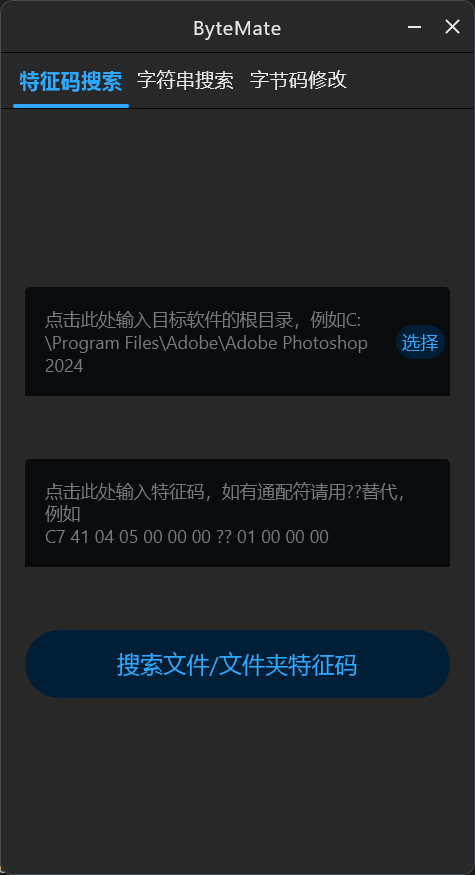

# ByteMate

[English](README.md) | [简体中文](README.zh-CN.md)

ByteMate 是基于 **Compose Multiplatform（Desktop）** 的开源跨平台桌面工具，主要用于二进制文件检索和分析。



## 功能

- 搜索文件或目录中的十六进制字节特征码，支持 `??` 通配符。
- 搜索文件及目录中的指定字符串。
- 解析 SQLite 数据库，并将结果导出为 JSON 或 CSV。
- 提供 Java/JAR 字节码操作工具（部分功能仅支持代码调用或仍处于实验阶段）。
- 仓库保留了 IntelliJ 相关的历史补丁页面。请仅处理你有权限修改的文件和软件；本项目不授予任何第三方软件的使用或修改许可。

## 中英文切换

支持英文与简体中文。系统语言为中文时默认显示简体中文，否则默认显示英文；可在窗口标题栏点击 **English / 中文** 实时切换，无需重启。

## 本地开发

**环境要求：** JDK 21、Windows / macOS / Linux。生成原生安装包时，需在对应操作系统上构建。

```bash
./gradlew run
./gradlew build
./gradlew packageDistributionForCurrentOS
```

在 Windows 的命令提示符或 PowerShell 中使用 `gradlew.bat`。安装包输出到 `build/compose/binaries/main/`。

## 自动打包与发布

GitHub Actions 在 PR 和推送到 `master` 时执行三平台构建。推送形如 `v1.0.1` 的版本标签后，会自动创建 GitHub Release，包含以下安装包：

- **Windows：** `.msi` 安装包
- **macOS：** `.dmg` 安装包
- **Linux：** `.deb` 安装包（Debian / Ubuntu）

发布示例：

```bash
git tag v1.0.1
git push origin v1.0.1
```

目前安装包**尚未进行代码签名**；Windows/macOS 可能弹出安全警告。正式公开分发前需另行配置签名及 macOS 公证。原生安装包也与构建机器的 CPU 架构有关。

## 开源协议

ByteMate 源代码使用 [MIT License](LICENSE)。第三方依赖分别遵守其自身协议。请勿使用本工具规避商业软件许可要求。
